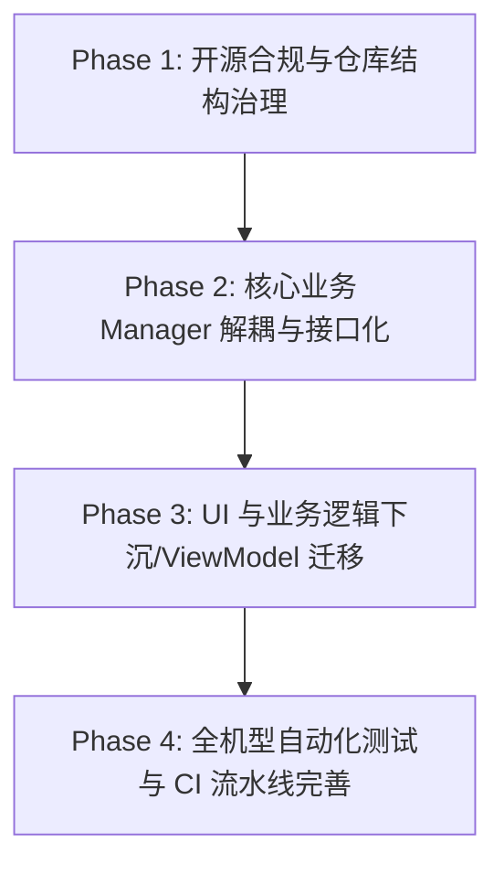

# 知止 (ZhiZhi) 实施计划与演进路线 (PLAN)

> **定位**：本文件是「知止」项目的**实现路线真相（Implementation Truth）**，记录当前已确认的工程目标、阶段里程碑、核心依赖与当前推进的工作状态。

---

## 1. 总体演进里程碑

### Phase 1: 开源合规与仓库结构治理（已完成闭环）
- **目标**：完成代码库的开源治理闭环，建立符合现代化规范的文件布局、治理契约、Local README 门禁与社区协作模版。
- **里程碑任务**：
  1. [x] 建立根级生活文档体系（`README.md`, `SPEC.md`, `PLAN.md`, `HISTORY.md`, `AGENT_CORE.md`）。
  2. [x] 为核心一级目录建立就地契约（`app/README.md`, `docs/README.md`, `scripts/README.md`）。
  3. [x] 净化 Java 源码集（移除 `Overview.md`，移出 `image/` 下非代码资源）。
  4. [x] 规范视觉资产（灯塔图标规范化命名并嵌入 README）。
  5. [x] 整理与清理本地调试转储文件（统一收录至 `.local_debug/` 并纳入 gitignore）。
  6. [x] 社区协作建设（添加 Issue 模版、PR 模版、`CONTRIBUTING.md`、`SECURITY.md`）。
  7. [x] 脚本测试鲁棒性修复（无外部私有真机日志时的安全跳过）。
  8. [x] 版本更迭日志建立（遵循 Keep a Changelog 的 `CHANGELOG.md`）。
  9. [x] 深度融合产品哲学理念与真实场景故事（`README.md`, `SPEC.md`, `docs/使用手册.md`）。

### Phase 2: 核心业务 Manager 解耦与接口化（进行中）
- **目标**：对照 `docs/ARCHITECTURE.md`，将巨型单例对象按单一职责拆分，转为接口与纯对象，提升可测试性。
- **重点重构对象**：
  1. `LockWindowManager`：拆分覆盖层生命周期、临时解锁到期重锁、休息面板与挑战控制器。
  2. `TimeRuleManager`：拆分 JSON 序列化、边界校验与时段计算算法。
  3. `MonitorService`：前台判定流水线抽为纯 Kotlin 对象（Seam 化），与 Android Service 容器解耦。
  4. `CreditManager`：拆分配额账本、黑名单计算与特权策略。

### Phase 3: UI 与业务逻辑下沉（中长期规划）
- **目标**：消除 Fragment 与 Activity 中的业务判定残留，全面推行 UseCase / Repository 架构。
- UI 层仅允许调用 Manager 接口，严禁直接读写业务 `SharedPreferences`。

### Phase 4: 全机型自动化测试与 CI/CD（发布保障）
- 引入 GitHub Actions 矩阵测试（兼容纯 JVM 单测与 Robolectric）。
- 完善主流厂商（Vivo / Xiaomi / Huawei / Samsung）无障碍与前台识别自动化真机测试用例。

### Phase 5: 权限演进技术储备与长期防御（Android 17+ 预研）
- **背景**：Android 17 高级保护模式可能进一步收紧侧载应用的 AccessibilityService（无障碍服务）。
- **技术应对路线**：
  - 预研双轨降级方案：`UsageStatsManager`（前台应用轮询轮查） + `SYSTEM_ALERT_WINDOW`（悬浮窗覆盖）。
  - 当系统无障碍权限被收紧或用户未授权无障碍时，可平滑降级为使用情况统计与定时轮询拦截，确保自律边界永不失守。

---

## 2. 当前工作台 (Current Work Summary)

- **当前分支**：`main`（已建立与 Gitee 远端同步 `git@gitee.com:my_room_welcome_you/zhizhi.git`，本地仅保留 `main` 与 `dev`）
- **当前重点**：
  - [x] 全面更名为「知止 (ZhiZhi)」，完成 Android 底层包名向 `com.zhizhi.app` 的平移。
  - [x] 完成配置备份向后兼容旧版 IronWill 导入，确保老用户无缝迁移。
  - [x] 成功构建普通用户可直接安装的签名 Release APK：`知止-ZhiZhi-v0.2.0-release.apk`。
  - [x] 规范主干与分支管理：重置 `main` 到最新提交，清理多余临时分支，并推送主干至 Gitee 仓库。
  - [x] 完善联系方式与双官网配置（GitHub / Gitee），修正 LogExporter 默认收件人，确立 4 要素问题反馈范式并同步法务与用户手册。
  - [x] 修复跨规则边界前台应用持续停留锁机失效漏洞：实现独立纯逻辑状态机 `ForegroundSessionTracker` 与双重边界跃迁门禁，联动治理 60s `ForegroundGuardFallbackGate`，覆盖 6 大场景纯 JVM 单元测试。

### 首页 UI 优化：弹性调度移除

- [x] 移除首页弹性调度入口、弹窗及专用 Manager 方法。
- [x] `:app:assembleDebug`、`:app:testDebugUnitTest` 与脚本测试通过（脚本 38 项，6 项按条件跳过）；未进行真机安装验证。
- 首页视觉方案仍在确认中，重点呈现当前状态、额度结余与借用。

### 起床系统：双阶段闹钟流程重构（离床验证 + 延迟关闭防沉迷）

- [x] 重构双阶段闹钟交互模型：将第一阶段定义为“离床验证”，第二阶段定义为“防回床延迟关闭缓冲（可选晨间任务）”。
- [x] 代码实现：`LockAlarmOverlay` 支持纯延迟倒计时自动解除闹钟、倒计时与任务双重门禁、持久化续接超时自动放行；`AlarmFragment` 与布局 XML 文案同步更新并允许第二阶段空任务。
- [x] 视频旁白同步：更新 `narration_count.py`、`video1_narration.md`、`video1_outline.md` 与 `video1_howto_outline.md`，阐明双阶段流程设计理念与自定义题库导入/版权保护规范。
- [x] 规范与决策文档回写：回写 `SPEC.md`、`PLAN.md`、`HISTORY.md`。

### 闹钟系统：默认设置持久化容错与测试闹钟全对齐闭环

- [x] 修复默认设置保存未生效：`getDefaultStage2Types` 先检查 `prefs.contains` 避免覆盖空集合；`cbAutoEscalate` 补齐读写联动。
- [x] 测试闹钟 100% 对齐新增闹钟：补齐「5分钟后自动升级到最大」、自定义铃声选择，且弹窗打开时全量自动预填默认设置。
- [x] 双向测试与保存闭环：测试弹窗支持「保存为默认设置」（保存后弹窗保持开启，方便继续测试）与「开始测试」；默认设置弹窗支持「测试当前配置」。
- [x] 自动化测试与打包：通过全部 880 个 Gradle 单元测试与 38 个 Python 回归测试；完成 Debug APK 构建。

## 3. 首页 UI 设计计划（待选型，不执行）

### 3.1 当前交付与候选

用户指定本轮只出 SPEC、PLAN 与可视化。应用实现暂停；不自动提交设计稿或进入开发。

三套候选使用相同示例数据，去掉规则与时段调整快捷按钮：

| 方案 | 默认信息结构 | 优势 | 代价 |
| --- | --- | --- | --- |
| A 额度账本（推荐） | 当前剩余大数字；本段/结余两行明细；已借提示；下一段扣减账本 | 无需点击就能理解结余和借用，时长与次数容易对照 | 页面较长，数字较多 |
| B 时长与次数分栏 | 两张纵向卡片，分别展示时长和次数的本段/结余；下方统一展示借用影响 | 每种单位单独阅读，避免混淆半次与分钟 | 两类指标对照需要移动视线 |
| C 总览与展开明细 | 当前剩余、结余摘要和已借提示常驻；详细分母与下一段扣减点击展开 | 首屏更简洁，仍保留结余和借用摘要 | 完整账本需要点击，明细发现成本较高 |

候选统一采用克制的暖白/深色背景、绿色主强调、橙色借用提示；颜色不替代文字含义。最终排版、颜色与展开行为等待用户选择。

### 3.2 展示口径与现有来源（代码审计）

| 信息 | 现有来源 | 展示约束 |
| --- | --- | --- |
| 当前及下一时段 | `TimeRuleManager.getCurrentSegment/getNextSegment` | 使用真实名称和时间；时段名称不等价于系统自动识别的学习/睡眠角色 |
| 当前剩余时长 | `CreditManager.getRemainingMinutes` | 保留原结果，含当前可用结余；不可把已借本金再次加上 |
| 当前剩余次数 | 现有 `computeCurrentUsableRemaining` 绑定，输入来自 CreditManager 与时段额度 | 保留半次格式 `formatUsableCountHalfUnits`，不得把内部整数直接当用户次数 |
| 本段剩余/额度、结余剩余/转入总额 | 现有 `calculateQuotaDetail` 与 `CreditManager.captureSurplusCarrySnapshot`、前序剩余额度 | 结余分母为真实转入快照，不是上一段全额；不得另造账本计算 |
| 已借时长/次数 | `CreditManager.getBorrowedMinutesFromNext/getBorrowedUsableCountFromNext` | 独立于当前剩余展示，零值状态明确；不是可再次消费的余额 |
| 规则借用上限 | 现有 `computeMaxBorrowableForNextSegment` | 该帮助函数以已借值 0 计算上限，因此只能叫「规则借用上限」，不能叫「还能借」；跨业务日显示不可借用 |
| 下一段原额度、借用扣减、扣减后额度 | 现有 HomeFragment 下一段展示绑定 | 沿用现有 ×2 展示口径，保留时长和次数两个维度；不在 UI 重算业务判定或承诺实际申请可通过 |
| 休息、特权、冷静期、临时放行、适应期 | 现有 CreditManager、LockWindowManager 与首页刷新流程 | 保留原优先级、条件、倒计时及操作校验 |
| 必要权限提示 | 现有首页权限检测与引导流程 | 只调整呈现，不改变检测、申请或确认流程 |

注意：历史代码仍有 UI 内展示计算及偏好读取；本次不把架构目标误报为当前已实现。若选定布局需要新增 Manager 接口或迁移业务计算，先单列设计变更，不能借 UI 重构扩大范围。

### 3.3 可视化示例与状态约束

- 仅用排版样例：当前剩余 25 分钟 / 2 次；本段 15/30 分钟、1/3 次；结余 10/20 分钟、1/2 次。
- 已借样例为 5 分钟 / 0.5 次；下一段原额度 60 分钟 / 4 次，扣减 10 分钟 / 1 次后展示 50 分钟 / 3 次。规则借用上限样例 15 分钟 / 1 次对应 50% 配置。样例不作为实际用户数据或新算法。
- 明细中「剩余/额度」与「剩余/转入」明确标注，避免分母含义混淆。
- 普通时段：显示余额、结余、已借与下一段信息；未借时不得显示扣减。
- 空档：不沿用已结束时段余额，不写「所有应用自由使用」；保留应用时间窗仍可能限制的准确提示。
- 跨业务日：明确「不可借用：下一业务日额度」，不得显示可借按钮或金额承诺。
- 无时段/无下一段：显示对应空态，不填假数据或用 0 伪装加载中。
- 休息/特权/冷静期/临时放行：按现有状态展示，保留结束操作及确认流程。
- 必要权限缺失、适应期：保留当前提示与入口；服务未就绪时不能宣称规则已全面执行。

### 3.4 选型后的文档步骤

1. 用户选择 A/B/C 或组合方案，确认明细默认展开程度。
2. 将选定信息层级、状态文案、交互、可访问性和验收条件补入 SPEC；PLAN 记录文件级实施顺序。
3. 后续四页逐页给出可视化并确认，沿用最初五页审计结果。首页的选择不自动批准其余四页。
4. 当前轮结束于设计文档；仅在用户另行明确授权执行后，才实施下述计划。

### 3.5 未来实施与验收计划（未执行）

1. 记录开发基线与现有未提交文件；仅修改选定页面，不混入其他文稿。
2. 首页主要修改 `fragment_home.xml`、首页专用 drawable/values 资源及 `HomeFragment.kt` 的必要展示绑定；不修改共享主题而导致其他四页意外变化。
3. 保留现有回调、广播、倒计时与额度计算。检查 add/hide/show 切页后的刷新；不得为新外观复制锁策略。
4. 以同一配置和业务日快照核对改前改后的余额、结余、已借、下一段扣减与半次显示；覆盖零结余、零借用、仅时长/仅次数借用、两者同时借用及跨业务日。
5. 运行 `python -m unittest discover -s scripts/tests` 与 `:app:assembleDebug :app:testDebugUnitTest`；按修改内容补充必要的展示契约测试，不重写算法测试。
6. 检查 320/360/412dp、字体放大、浅/深色、长时段名；触摸目标至少 48dp，TalkBack 能读出数值所属字段，颜色不是唯一提示。
7. 有设备且获执行授权后覆盖安装验证，使用 `adb install -r -d`，禁止卸载；检查导航、展开收起、状态刷新及 crash 日志。
8. 首页独立提交并报告文件、前后差异、业务影响与验证结果；再按专注规则 → 统计 → 闹钟 → 设置逐页实施与验证。

设计阻断项：生效策略的 SPEC 表述与 `EffectiveActivationPolicyManager` 说明存在冲突，未完成执行判定核对。本轮不改业务、不替该规则下新结论；进入专注规则/设置文案设计时必须先解决事实口径。

### 3.6 锁机悬浮窗联动审计与候选

代码事实：`LockWindowManager` 为 DND 与 APP_WINDOW 共用 `window_lock_screen.xml`。两种模式共享额度绑定；APP_WINDOW 模式覆盖触发原因、受限应用、允许时间窗以及“申请特权”主操作，DND 模式使用“申请休息”。当前轻量刷新还会同步更新余额、次数和结余明细。

| 候选 | 勿扰时间锁 | 应用时间窗锁 | 判断 |
| --- | --- | --- | --- |
| A 完整同步 | 完整额度与下一段账本 | 同样完整展示 | 与当前实现最接近，但时间窗说明、账本和多个解锁操作同时出现，认知负担最高 |
| B 按原因裁剪（推荐） | 当前余额 + 本段/结余 + 已借；下一段仅一行摘要 | 受限应用 + 允许时段优先；当前余额 + 已借摘要；隐藏下一段完整账本 | 保持同源数据，又让每个锁屏回答当下最重要的问题 |
| C 极简锁屏 | 仅当前余额与主操作 | 仅原因、允许时段与主操作 | 最清爽，但借用成本与结余去向不够透明 |

推荐 B。具体约束：

- 两种锁都先回答“为什么被拦截”和“现在能做什么”，额度是支持决策的信息，不能压过触发原因。
- DND 锁默认展示“当前可用总额”，并把本段、结余和已借压缩为两至三行；下一段仅在已借时显示“下一段将扣减…”摘要，不展示常驻六行账本。
- APP_WINDOW 锁默认不展示下一段 DND 卡片，因为它不能解释应用为何在当前时间窗外；保留“当前可用于临时放行”的时长/次数与已借状态，帮助用户判断超级临时入口的代价。
- APP_WINDOW 锁的允许时间窗必须高于额度摘要；如果今日无可用窗口，使用现有回退文案，不虚构下次开放时间。
- “规则借用上限”只能在进入实际休息/临时放行申请流程后显示，并结合已借额度重新校验；锁屏摘要不把静态上限写成“还能借”。
- 借用 ×2 的精确扣减在确认覆盖层显示；锁屏可用“已借 5 分钟，下一段扣 10 分钟”这种结果文案，不重复展示公式。
- 休息冷却、临时放行冷却、惩罚计数继续保留，但只在对应状态出现；不与普通额度说明并列堆满首屏。
- 实施仍处于暂停状态。本轮只维护 SPEC、PLAN 和候选可视化。
