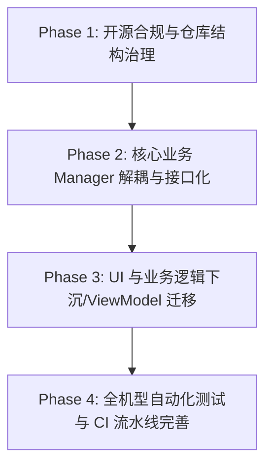

# 知止 (ZhiZhi) 实施计划与演进路线 (PLAN)

> **定位**：本文件是「知止」项目的**实现路线真相（Implementation Truth）**，记录当前已确认的工程目标、阶段里程碑、核心依赖与当前推进的工作状态。

---

## 1. 总体演进里程碑

### Phase 1: 开源合规与仓库结构治理（已完成闭环）
- **目标**：完成代码库的开源治理闭环，建立符合现代化规范的文件布局、治理契约、Local README 门禁与社区协作模版。
- **里程碑任务**：
  1. [x] 建立根级生活文档体系（`README.md`, `SPEC.md`, `PLAN.md`, `HISTORY.md`, `AGENT_CORE.md`）。
  2. [x] 为核心一级目录建立就地契约（`app/README.md`, `docs/README.md`, `scripts/README.md`）。
  3. [x] 净化 Java 源码集（移除 `Overview.md`，移出 `image/` 下非代码资源）。
  4. [x] 规范视觉资产（灯塔图标规范化命名并嵌入 README）。
  5. [x] 整理与清理本地调试转储文件（统一收录至 `.local_debug/` 并纳入 gitignore）。
  6. [x] 社区协作建设（添加 Issue 模版、PR 模版、`CONTRIBUTING.md`、`SECURITY.md`）。
  7. [x] 脚本测试鲁棒性修复（无外部私有真机日志时的安全跳过）。
  8. [x] 版本更迭日志建立（遵循 Keep a Changelog 的 `CHANGELOG.md`）。
  9. [x] 深度融合产品哲学理念与真实场景故事（`README.md`, `SPEC.md`, `docs/使用手册.md`）。

### Phase 2: 核心业务 Manager 解耦与接口化（进行中）
- **目标**：对照 `docs/ARCHITECTURE.md`，将巨型单例对象按单一职责拆分，转为接口与纯对象，提升可测试性。
- **重点重构对象**：
  1. `LockWindowManager`：拆分覆盖层生命周期、临时解锁到期重锁、休息面板与挑战控制器。
  2. `TimeRuleManager`：拆分 JSON 序列化、边界校验与时段计算算法。
  3. `MonitorService`：前台判定流水线抽为纯 Kotlin 对象（Seam 化），与 Android Service 容器解耦。
  4. `CreditManager`：拆分配额账本、黑名单计算与特权策略。

### Phase 3: UI 与业务逻辑下沉（中长期规划）
- **目标**：消除 Fragment 与 Activity 中的业务判定残留，全面推行 UseCase / Repository 架构。
- UI 层仅允许调用 Manager 接口，严禁直接读写业务 `SharedPreferences`。

### Phase 4: 全机型自动化测试与 CI/CD（发布保障）
- 引入 GitHub Actions 矩阵测试（兼容纯 JVM 单测与 Robolectric）。
- 完善主流厂商（Vivo / Xiaomi / Huawei / Samsung）无障碍与前台识别自动化真机测试用例。

### Phase 5: 权限演进技术储备与长期防御（Android 17+ 预研）
- **背景**：Android 17 高级保护模式可能进一步收紧侧载应用的 AccessibilityService（无障碍服务）。
- **技术应对路线**：
  - 预研双轨降级方案：`UsageStatsManager`（前台应用轮询轮查） + `SYSTEM_ALERT_WINDOW`（悬浮窗覆盖）。
  - 当系统无障碍权限被收紧或用户未授权无障碍时，可平滑降级为使用情况统计与定时轮询拦截，确保自律边界永不失守。

---

## 2. 当前工作台 (Current Work Summary)

- **当前分支**：`main`（已建立与 Gitee 远端同步 `git@gitee.com:my_room_welcome_you/zhizhi.git`，本地仅保留 `main` 与 `dev`）
- **当前重点**：
  - [x] 全面更名为「知止 (ZhiZhi)」，完成 Android 底层包名向 `com.zhizhi.app` 的平移。
  - [x] 完成配置备份向后兼容旧版 IronWill 导入，确保老用户无缝迁移。
  - [x] 成功构建普通用户可直接安装的签名 Release APK：`知止-ZhiZhi-v0.2.0-release.apk`。
  - [x] 规范主干与分支管理：重置 `main` 到最新提交，清理多余临时分支，并推送主干至 Gitee 仓库。

