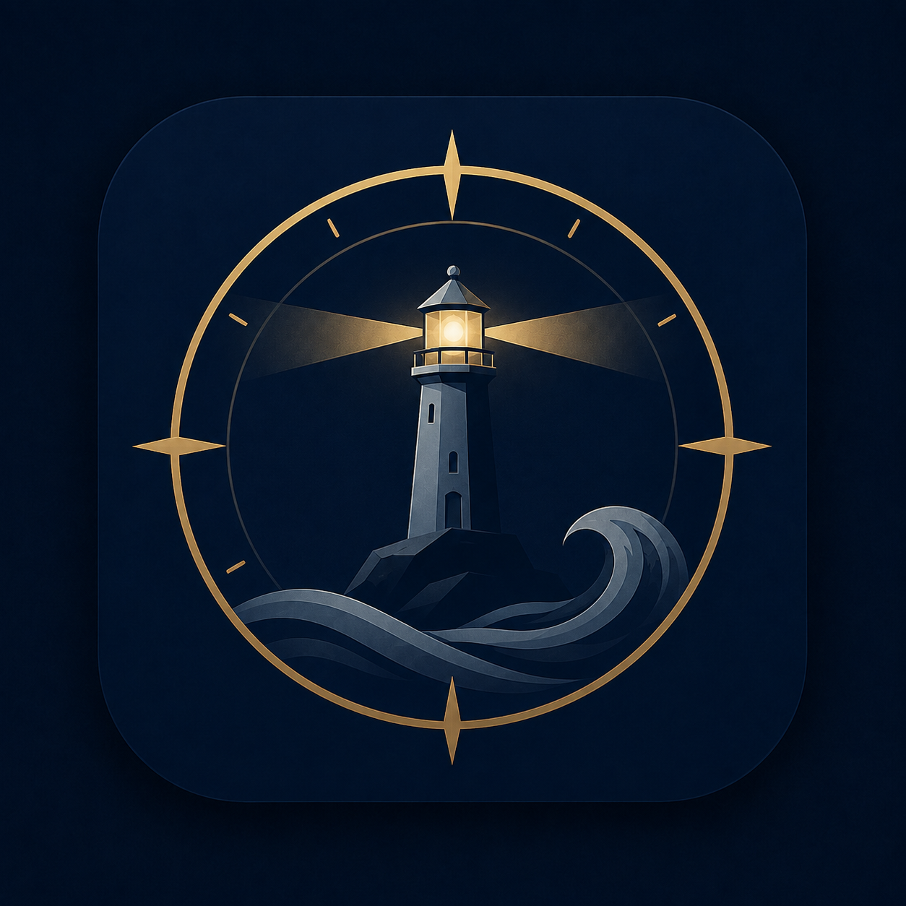
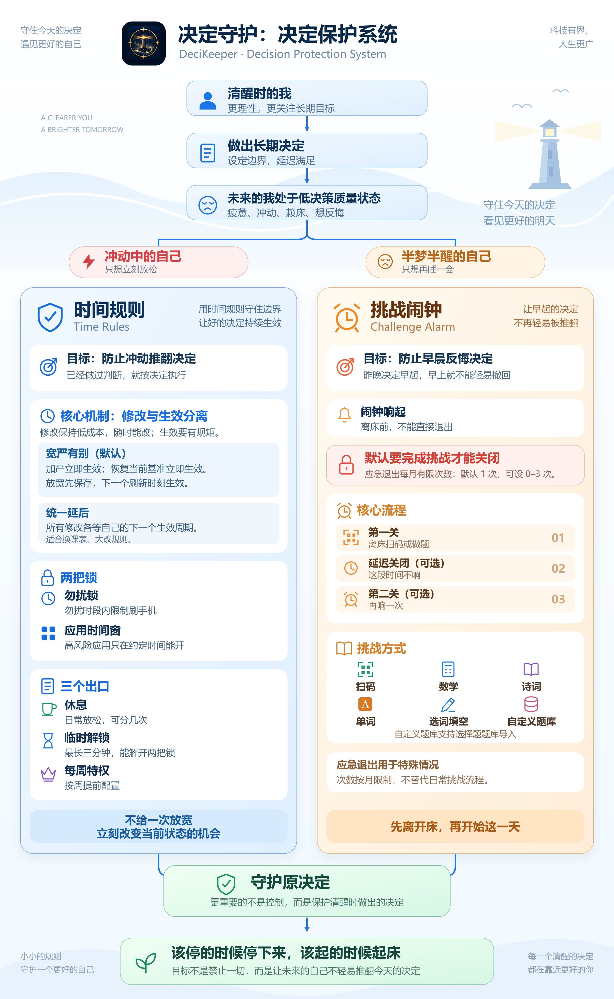

<div align="center">



# 决定守护 DeciKeeper

**决定守护不是控制手机。它是一个决定保护系统，帮助你保护清醒时为未来做出的决定。**

> **可以休息，也可以反悔，但别让一时冲动立刻推翻昨天的决定。不是禁止自由，而是管理自由。**

[](LICENSE)
[](app/build.gradle.kts)
[](.github/CONTRIBUTING.md)

[📥 下载体验](#下载) ·
[🚀 快速上手](docs/user/getting-started.md) ·
[📖 功能指南](docs/user/guide.md) ·
[🔐 权限与保活说明](docs/user/permissions.md) ·
[💬 交流与反馈](#交流与反馈) ·
[🛠️ 开发者指南](.github/CONTRIBUTING.md)

<br/><br/>



</div>

---

## 决定守护是什么？

决定守护是一款**决定保护软件**。

它不替用户决定：

> 什么事情值得做。

它保护的是：

> 用户清醒时，为未来做出的决定。

很多时候，人并不是不知道正确方向。问题在于：当决定真正需要执行的时候，状态已经发生变化。

晚上认真做出的「今天早点睡」，常常败给下一刻的「再刷一个视频」。决定守护关注的，就是这种**已经做出决定、但执行时容易被当前状态改变的时刻**。

决定守护不做包罗万象的泛自律，它的守护范围**严格局限在两处最容易被冲动和生理状态击穿的现实边界**：
1. **受手机影响的使用边界**（该停的时候停下来）：防范短视频、游戏、聊天和信息流对学习、工作与睡眠的无节制侵占；
2. **早晨起床的行动边界**（该起的时候起来）：击破清晨半梦半醒时的赖床惯性，推动真正离开床铺并完成清醒过渡。

---

## 两个核心模块

> **按需选用，完全独立**：
> - **用闹钟只设置闹钟即可**：无需配置任何时间规则，闹钟独立运行；
> - **只使用时间规则时**：第一次**不需要加应用时间窗**，只需设置**勿扰时段**（受限时段）与**特权时段**（自由时段）即可轻松起步；后续有单个应用单日限额需求时再按需添加。

### 1. 时间规则 —— 保护你已经决定的使用边界

- **面对**：冲动中的自己
- **解决**：想立即推翻规则
- **方式**：
  - **两把锁**：勿扰时段锁 + 应用时间窗锁，把高风险应用和无休止的信息流隔离在外；
  - **加严立即，放宽延期**：缩短允许时间立即生效，临时放宽延到下一生效时刻，杜绝冲动秒反悔；
  - **分级自由出口**：临时解锁 / 休息 / 每周特权。

### 2. 挑战闹钟 —— 保护你已经决定的行动

- **面对**：半睡半醒的自己
- **解决**：不想开始行动
- **方式**：
  - **真实行动挑战**：扫码、计算、单词、诗词、选词填空、自定义题库。真正起作用的是二维码的物理位置；
  - **完成后的缓冲**：第一关完成后提醒降到最低强度，给洗漱、收拾、出门留出一段温和过渡；
  - **可选的第二关**：让刚醒的大脑再多清醒一点。

---

## 为什么这两个模块属于同一个产品

时间规则限制手机使用，挑战闹钟帮助早起，看起来是两件事。但它们解决的是同一个问题：

```text
清醒时做出决定
      ↓
未来状态变化
      ↓
执行困难
      ↓
需要额外保护
```

决定守护不是单纯的手机限制工具，也不是单纯的闹钟工具。它关注的是：

> 如何让已经认真考虑过的决定，在未来真正发生。

完整的产品意图与设计理由见 [产品总览](docs/product/system-overview.md)。

---

## 核心机制

### 1. 加严立即，放宽延期

正常保护期内，受保护规则的修改遵循：

- **加严**：立即生效；
- **放宽**：延期到下一合法生效时刻。

例如缩短游戏允许时间可以立即生效；临时把 1 小时放宽到 3 小时，不会因为一时冲动马上生效。

> **可以反悔，但别秒反悔。**

### 2. 两把锁

- **勿扰时段锁**：规定一天中哪些时间进入限制状态；
- **应用时间窗锁**：规定某些高风险应用什么时候才允许使用。

两把锁是叠加关系：应用同时受两把锁约束时，普通使用必须同时满足两者。

### 3. 分级自由出口

决定守护不是禁止自由，而是管理自由。三个出口对应不同的现实需求：

- **临时解锁**：处理扫码、验证码、临时消息这类短时间的现实需求。时间短，不改变规则，只是临时通过。
- **休息**：主动恢复。只解除勿扰时段锁，**不解除应用时间窗锁**——休息不等于无限放纵。
- **每周特权**：用于聚会、假期这类特殊情况，可以越过更多限制，但使用次数有限，不作为日常出口。

额度、结余、借用与冷却的具体口径见 [时间规则规格](docs/specs/focus.md)。

### 4. 起床不是「把闹钟做得更响」

宿舍里的矛盾不是单纯「声音不够大」：手机放在床边比较不容易持续吵到室友，但也意味着半睡半醒时伸手就能把普通闹钟关掉。

决定守护把「关闭闹钟」变成一次真实行动：

> **扫描任意二维码即可通过。真正起作用的是二维码的物理位置。**

你可以把二维码放在卫生间、客厅或洗手台，让完成第一关必须伴随真实离床动作。计算、单词等挑战则用于帮助刚醒的大脑进入清醒状态。

第一关之外还有再响、完成后延迟缓冲和可选第二关，详细规则见 [起床闹钟规格](docs/specs/alarm.md)。

### 5. 保护的是决定，不是永久绑住用户

决定守护提供防卸载、防关关键权限、隐私空间 / 特殊系统入口、闹钟挑战防关机等加强保护。

这些机制的目标不是让用户永远无法退出，而是增加冲动拆规则的摩擦。**用户最终必须能够按产品规则关闭保护并退出。**

不同 Android ROM 的行为差异很大，因此不承诺「绝对无法绕过」，而是持续补强真实发现的绕过路径。

详细规则见 [保护机制规格](docs/specs/protection.md)。

---

## 下载

| 渠道 / 资产 | 最新安装包 | 特性与适用说明 |
| :--- | :--- | :--- |
| **GitHub Releases（推荐）** | [**`DeciKeeper-v0.3.0-arm64.apk`**](https://github.com/Iwillbecomestrong/DeciKeeper/releases/download/v0.3.0/DeciKeeper-v0.3.0-arm64.apk) | 物理零联网、无网络权限、纯单机运行，主流 64 位 Android 手机直接安装 |
| **GitHub Releases 页面** | [全部版本与校验文件 (Releases)](https://github.com/Iwillbecomestrong/DeciKeeper/releases) | 提供完整发布说明与 `.sha256` 完整性校验文件 |
| **Gitee Releases** | [Gitee 发行版](https://gitee.com/my_room_welcome_you/zhizhi/releases) | 国内镜像发布通道 |

---

## 第一次使用

1. 安装最新 APK；
2. **不要一上来就开启防卸载。** 先按应用内指引开启首页的 4 项基础权限（悬浮窗、通知、后台耗电管理、自启动），配置一两个简单的勿扰时段和应用时间窗，确认锁屏、前台检测和后台存活都正常；
3. 确认基础功能稳定后，再考虑开启无障碍以及依托无障碍的加强约束。

完整上手流程见 [快速上手](docs/user/getting-started.md)。

---

## 交流与反馈

- **交流反馈 QQ 群**：**`980203768`**（日常交流、自律心得、快速排查与内测发布）
- **开发者邮箱**：**`cyz200303@163.com`**
- **问题反馈**：欢迎通过 GitHub Issues 提交问题（⚠️ **请勿在公开 Issue 中直接上传导出的运行日志**，日志包含你手机的前台应用包名与使用时间戳等个人隐私；如需排查日志或反馈绕过防线的 Bug，请通过邮件或 QQ 群私信发送）

---

---

## 用户指南与文档

为了帮助你更好地用好「决定守护」，我们准备了详尽的用户指南（同时也是 App 内【设置 → 使用说明】的原生内置内容）：

- [🚀 快速上手指南](docs/user/getting-started.md)：5 分钟走通勿扰规则与起床挑战；
- [📖 核心功能完全指南](docs/user/guide.md)：勿扰时段、应用时间窗、分级自由出口与挑战模式详解；
- [🔐 权限与全机型保活指南](docs/user/permissions.md)：各大品牌手机（vivo、小米、华为、OPPO 等）后台防冻结与睡眠优化配置。

---

## 🛠️ 代码贡献与开发者指南

决定守护（DeciKeeper）完全开源。如果你是代码贡献者或开发者，希望在本地编译调试代码、了解底层规格或为本项目提交 Pull Request，请移步阅读专属的：

👉 **[【代码贡献与开发者指南 (.github/CONTRIBUTING.md)】](.github/CONTRIBUTING.md)**

开发者指南包含：
- **软件界面与文档源码对应表**（在哪里看 / 在哪里改）；
- **本地环境与构建命令**（Gradle 编译、1300+ 单元测试运行、真机覆盖安装红线）；
- **系统核心架构契约**（[SPEC.md](SPEC.md) 与各模块规格定义）；
- **代码分层与命名规范**；
- **10 条系统业务红线**与关键文件地图。

---

## 开源与数据许可

- 源代码按 [GPL-3.0](LICENSE) 协议发布；
- 题库数据来源与版权边界见 [docs/DATA_SOURCES.md](docs/DATA_SOURCES.md)；
- 第三方组件许可证见 [docs/THIRD_PARTY_NOTICES.md](docs/THIRD_PARTY_NOTICES.md)。

---

决定守护会继续围绕一个简单方向迭代：

> **该停的时候停下来，该起的时候起来。**
