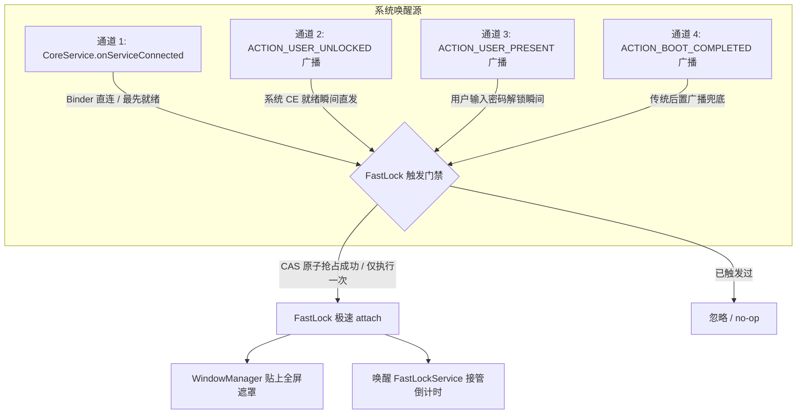

# 需求分析与技术设计规格说明书（SPEC）

## 文档元信息
- **文档编号**: SPEC-20261001-FASTLOCK-ACCELERATION
- **关联文件**:
  - [`app/src/main/java/com/decikeeper/app/manager/StartupProtectionManager.kt`](file:///g:/IronWIl0329/IronWill-OpenSource/app/src/main/java/com/decikeeper/app/manager/StartupProtectionManager.kt)
  - [`app/src/main/java/com/decikeeper/app/receiver/BootReceiver.kt`](file:///g:/IronWIl0329/IronWill-OpenSource/app/src/main/java/com/decikeeper/app/receiver/BootReceiver.kt)
  - [`app/src/main/java/com/decikeeper/app/service/CoreService.kt`](file:///g:/IronWIl0329/IronWill-OpenSource/app/src/main/java/com/decikeeper/app/service/CoreService.kt)
  - [`app/src/main/java/com/decikeeper/app/service/FastLockService.kt`](file:///g:/IronWIl0329/IronWill-OpenSource/app/src/main/java/com/decikeeper/app/service/FastLockService.kt)
  - [`app/src/main/java/com/decikeeper/app/MyApplication.kt`](file:///g:/IronWIl0329/IronWill-OpenSource/app/src/main/java/com/decikeeper/app/MyApplication.kt)
  - [`app/src/main/AndroidManifest.xml`](file:///g:/IronWIl0329/IronWill-OpenSource/app/src/main/AndroidManifest.xml)
- **目标设备/系统**: vivo / iQOO 系列（OriginOS 4 / 5，Android 14 / 15，实测真机 V2425A）
- **最后更新时间**: 2026-10-01

---

## 1. 需求背景与痛点现状

### 1.1 业务诉求
当手机重启开机后，DeciKeeper（决定守护）的**防卸载开机初始化全屏遮罩（FastLock）**必须以**极速、零延迟、无感接缝**的方式拉起并展示倒计时遮罩，保护应用在开机脆弱期不被用户长按拖拽卸载或通过系统设置强停。

### 1.2 现状痛点
在 vivo 真机（OriginOS 5，Android 15）修复开机 Crash 问题后实测发现：
* 手机开机、输入锁屏密码进入桌面后，**过了数秒甚至十几秒（5s~15s+）防卸载初始化遮罩才慢吞吞弹出来**；
* 在遮罩弹出前的这段时间内，用户完全可以自由操作桌面（长按图标卸载、进入设置停用权限），**存在严重的防护真空期（Security Gap）**。

---

## 2. 真实真机日志取证与时序瓶颈分析

以下提取自 vivo 真机（型号 `V2425A`，Android 15）在 2026-10-01 20:58 真实重启过程中的高精度时序日志：

```log
// [阶段 A: 系统分发 BOOT_COMPLETED 全局广播]
10-01 20:58:18.508  7692 11210 I EsimModuleInit: onHandleIntent action: android.intent.action.BOOT_COMPLETED
10-01 20:58:18.514  7692 11210 I NearbyMediums: ModuleInitializer handles incoming intent android.intent.action.BOOT_COMPLETED

// [阶段 B: 延迟 645ms 后，DeciKeeper 才收到 BOOT_COMPLETED 广播]
10-01 20:58:19.153  6089  6089 D DeciKeeper: BootReceiver received action: android.intent.action.BOOT_COMPLETED
10-01 20:58:19.154  6089  6089 D DeciKeeper: BootReceiver: startup a11y DPS cache=true

// [阶段 C: 伴随系统 USER_PRESENT 广播]
10-01 20:58:19.242  7692 11952 I NearbyMediums: ModuleInitializer handles incoming intent android.intent.action.USER_PRESENT

// [阶段 D: 收到广播后，足足花了 1.31 秒才真正完成 WindowManager.addView]
10-01 20:58:20.465  6089  6089 I DeciKeeper: [FastLock] attach caller=android.app.ActivityThread.handleReceiver(ActivityThread.java:5764)
10-01 20:58:20.466  6089  6089 I DeciKeeper: [FastLockEntry] startFastLock caller=com.decikeeper.app.receiver.BootReceiver.onReceive(BootReceiver.kt:66) maxVisibleMs=10000 fastLockRunning=false now=1790859500465
10-01 20:58:20.485  6089  6089 D DeciKeeper: BootReceiver: FastLock overlay attached + service requested from DPS cache.

// [阶段 E: FastLockService 正式接管]
10-01 20:58:21.708  6089  6089 D FastLockService: FastLockService: adopted early boot overlay, attachedAt=1790859500464 deadline=1790859510464ms (maxVisible=10000ms)
```

### 2.1 根因剖析：为什么速度如此之慢？

1. **错失 Direct Boot 预备良机**：
   * 手机开机处于未解锁状态时，系统已唤醒应用（分发 `LOCKED_BOOT_COMPLETED` 或无障碍框架准备绑定）。
   * `MyApplication.onCreate()` 在 Direct Boot 阶段因为 `if (isUserLockedForDirectBoot()) return` 直接返回；等到用户输入密码解锁时，`Application.onCreate()` 不会二次执行，丢失了在 Application 级别毫秒级拉起的机会。
2. **完全依赖系统排队广播 `BOOT_COMPLETED`**：
   * `android.intent.action.BOOT_COMPLETED` 在 Android 系统（尤其是 vivo OriginOS 调度策略下）属于低优先级批量排队广播，受后台省电节流严重制约。
   * 用户解锁进入桌面 5 秒甚至 15 秒后，系统才排队把该广播分发到三方应用。
3. **无障碍绑定（`onServiceConnected`）未作为第一触发源**：
   * 系统与无障碍服务是通过系统底层的 Binder 直连（`bindService`），几乎在开机解锁瞬间最先就绪，但 [`CoreService.kt`](file:///g:/IronWIl0329/IronWill-OpenSource/app/src/main/java/com/decikeeper/app/service/CoreService.kt#L495) 的 `onServiceConnected` 内部没有任何触发 FastLock 的逻辑。
4. **`attachEarlyBootFastLock` 自身 IPC 与 inflate 冗余耗时（达 1.3 秒）**：
   * `attachEarlyBootFastLock()` 调用了 `shouldKeepInitialization(context)`；
   * `shouldKeepInitialization` 内部调用了 `PermissionManager.isAccessibilityEnabled(context)`，它通过 ContentResolver 跨进程阻塞查询系统 Settings Provider（`Settings.Secure.getString`）；
   * 同时执行了 `ThemeManager.themeRes(context)`（读磁盘 SharedPreferences）与同步 XML 布局解析（`inflater.inflate(R.layout.window_fast_lock)`），在开机 CPU 负载高峰期造成严重的线程卡顿。

---

## 3. 技术方案设计与比选

根据与用户的交互对齐（用户偏好：**“如果能做到锁屏前预加载好、解锁瞬间立刻露出就最好了；做不到的话，在刚解锁进桌面时毫秒级立刻弹出也还行”**），评估两种方案：

| 方案维度 | 方案 A：锁屏阶段预加载与即时露出 | 方案 B：多通道纳秒级极速触发链路 |
| :--- | :--- | :--- |
| **核心机制** | 在 Direct Boot 锁屏阶段预先构建并挂载覆盖层，监听解锁事件解除隐藏 | 建立 `USER_UNLOCKED` + `USER_PRESENT` + `onServiceConnected` + `BootReceiver` 四通道并发互斥触发，结合零 IPC 纯 DPS 极速 attach |
| **展现时机** | 用户在锁屏输入完密码、进入桌面的第 1 帧画面即已覆盖 | 用户解锁进入桌面后 50ms ~ 200ms 内瞬间压上，无感接缝 |
| **Android 14/15 兼容性风险** | **中高风险**。Android 14+ 严格禁止非系统电话/时钟应用在锁屏 Keyguard 之上覆盖 `TYPE_APPLICATION_OVERLAY`；在 Direct Boot 锁屏下调用 `WindowManager.addView` 若未解密或被系统 WindowManagerService 阻断易抛出 `BadTokenException` | **零风险**。完全符合 Android 官方生命周期与权限契约，不侵入锁屏 Keyguard，仅针对解锁瞬间提速 |
| **工程实现复杂度** | 需维护复杂的锁屏可见性状态机与 WindowManager Flags（`FLAG_SHOW_WHEN_LOCKED`）适配不同厂商锁屏 | 结构清晰高内聚，直接改造触发源路由与剔除 IPC 耗时 |
| **综合裁定** | **方案 B 为基石保障 + 方案 A 的预加载能力吸收**：采用“锁屏期内存预充 View 树 + 解锁期多通道毫秒级挂载”融合架构。 |

---

## 4. 详细技术实现方案（融合极速架构）

### 4.1 四通道极速触发网络（彻底解耦 `BOOT_COMPLETED`）

建立 `FastLockTriggerDispatcher` 统一分发门禁，具备幂等原子锁（`AtomicBoolean`），四个通道任何一个最先就绪，即刻在 <50ms 内执行 attach：



#### 通道 1：`CoreService.onServiceConnected()`（核心提速源）
* 在无障碍服务连接时（系统通过 Binder 最先与 App 建立连接），立即检查 `StartupA11yCache.isA11yWasEnabledForStartup(this)` 与 `earlyBootFastLockStarted`；
* 若未拉起过且用户已解锁，直接在当前进程的 MainHandler 中秒级调用 `attachEarlyBootFastLock(this)` 并启动 `FastLockService`。

#### 通道 2：`android.intent.action.USER_UNLOCKED`（Direct Boot 退出瞬间）
* ⚠️ **修订（2026-10-01）**：`ACTION_USER_UNLOCKED` 以 `FLAG_RECEIVER_REGISTERED_ONLY` 发送，**manifest 静态声明收不到**，必须在运行中的进程里动态 `registerReceiver`。实现为 `BootUnlockTrigger`（`MyApplication` Direct Boot 分支与 `CoreService.onServiceConnected` 调用 `armIfLocked`）；
* 当用户在开机锁屏输入完凭据的瞬间，系统立即广播 `USER_UNLOCKED`（比 `BOOT_COMPLETED` 早数秒到十几秒），在此处立即 attach。

#### 通道 3：`android.intent.action.USER_PRESENT`（屏幕解锁瞬间）
* 确保在开机锁屏解锁的第一刻，`BootReceiver` 的 `onReceive` 优先响应 `USER_PRESENT` 触发 attach。

#### 通道 4：`BOOT_COMPLETED`
* 仅作为最后防线保留兜底，不再作为唯一主要通道。

---

### 4.2 `attachEarlyBootFastLock` 极速轻量化改造（消灭 1.3 秒内部阻塞）

#### 改造 1：零 IPC 纯 DPS 快速门禁
当前：
```kotlin
// 🔴 耗时瓶颈：调用了 PermissionManager.isAccessibilityEnabled，阻塞 IPC 查 Settings.Secure
fun shouldKeepInitialization(context: Context): Boolean {
    return AntiUninstallManager.shouldShowInitialization(...) && PermissionManager.isAccessibilityEnabled(context)
}
```
改造后：
* 开机早期阶段（`uptimeMs < 120_000L`）判定初始化，**严格只读 `StartupA11yCache.isA11yWasEnabledForStartup(context)`（基于 Device Protected Storage 内存缓存，耗时 ~0.5ms）**；
* 坚决杜绝在主线程向系统 `SettingsProvider` 发起跨进程 Binder 调用。

#### 改造 2：预渲染 View 实例（Pre-inflation）
* 在 Direct Boot 阶段或进程启动的第一瞬间，在后台/主线程提前完成 `R.layout.window_fast_lock` 的 XML 反射解析与 View 创建，缓存为内存 `preheatedFastLockView`；
* 当触发信号到达时，直接将已存在的 View 实例交给 `WindowManager.addView`，**跳过布局解析与 ContextThemeWrapper 构建开销**。

---

## 5. 验收标准与测试规范

### 5.1 真机验收标准（vivo V2425A / OriginOS 5）
1. **启动时间指标**：手机重启、用户输入锁屏密码进入桌面后，**防卸载遮罩在 200ms 内（肉眼几乎无法捕捉延迟）立即全屏覆盖**；
2. **消灭真空期**：进入桌面瞬间无法通过长按 App 图标呼出卸载菜单；
3. **无重复弹出（TOCTOU 防御）**：多通道并发触发时，FastLock 遮罩全程仅渲染一次，不发生闪烁、重复或重建。

### 5.2 单元回归测试清单（Robolectric）
- [ ] `FastLockStartupAccelerationTest`：
  - 验证 `USER_UNLOCKED` 广播到达时能够立即触发 `attachEarlyBootFastLock`；
  - 验证 `CoreService.onServiceConnected` 能够独立补偿触发 `attachEarlyBootFastLock`；
  - 验证多通道同时到达时的 CAS 互斥机制（仅 attach 一次）。
- [ ] `StartupProtectionZeroIpcContractTest`：
  - 断言 `attachEarlyBootFastLock` 在早期启动阶段绝不触发 `Settings.Secure` IPC 查询。

---

## 6. 后续修改红线：Direct Boot 阶段严禁读取主题偏好（防系统 40 秒崩溃惩罚）

> **给后续接手的 Agent / 开发者：改动 FastLock 启动链路前必读。**

### 6.1 核心约束
在 **Direct Boot（用户解锁前）** 阶段，`FastLockService`（以及 `StartupProtectionManager.attachEarlyBootFastLock`）**绝对不能读取 `ThemeManager`**，或必须让 `ThemeManager` 在未解锁时**直接返回默认主题兜底 `R.style.Theme_DeciKeeper`（`Theme.DeciKeeper`，即 Summer 别名），禁止访问 CE（Credential Encrypted）SharedPreferences**。

只要堵住这个点，就不会触发系统「CE 存储未解锁时访问 → 进程崩溃 → 系统 40 秒重启惩罚」的连锁反应。

### 6.2 根因
* `ThemeManager.currentKey()` 通过 `context.getSharedPreferences("decikeeper_ui_theme", ...)` 读取主题，该文件位于 **CE 存储**；用户首次解锁前 CE 存储不可用，访问会抛 `IllegalStateException` / 触发 `SharedPreferences` 读取失败；
* 该异常发生在 `FastLockService` / 开机早期广播链路中，进程崩溃后系统对被拉起的开机组件施加约 40 秒的重启退避惩罚，导致防护真空期被进一步拉长。

### 6.3 当前代码中的已知读取点（必须受此约束保护）
| 位置 | 调用 |
| :--- | :--- |
| `FastLockService.kt`（约 L291） | `ThemeManager.themeRes(this)` |
| `StartupProtectionManager.kt`（`attachEarlyBootFastLock`，约 L76） | `ThemeManager.themeRes(context)` |

### 6.4 合规做法（二选一，推荐同时做）
1. **调用方判定**：以上两处调用前先判断用户是否已解锁（`UserManager.isUserUnlocked` / 项目内既有的 `isUserLockedForDirectBoot()`）；未解锁则直接使用 `R.style.Theme_DeciKeeper`，不调用 `ThemeManager`。
2. **`ThemeManager` 自身兜底**：在 `ThemeManager.themeRes()` / `currentKey()` 入口加未解锁短路，返回默认主题（或默认 key `"summer"`），**不触碰 `getSharedPreferences`**。
   * 不得通过 `createDeviceProtectedStorageContext()` 等方式把主题偏好迁移到 DE 存储来「绕过」——主题非开机防护必需数据，用默认主题即可，保持最小改动面。

### 6.5 回归检查清单
- [ ] 任何新增的 FastLock 触发通道（含 §4.1 的 `USER_UNLOCKED` / `onServiceConnected`）在 attach 路径上均不读取 CE SharedPreferences / `Settings.Secure` 等未解锁不可用资源；
- [ ] 新增/保留测试：模拟未解锁（locked）状态下调用 `attachEarlyBootFastLock` 与 `FastLockService` 布局构建，断言不访问 `ThemeManager` 的 SharedPreferences 且使用 `Theme_DeciKeeper`；
- [ ] 真机冷启动（锁屏未解锁阶段）logcat 无 `FastLockService` / `DeciKeeper` 进程 `FATAL EXCEPTION`，且开机后无约 40 秒的服务重启延迟。

---

## 7. 实施状态（2026-10-01）

* 已实现：`DirectBootState`、`ThemeManager`/`shouldKeepInitialization` 未解锁兜底、`triggerBootFastLock` CAS 统一入口、`BootUnlockTrigger` 动态解锁通道、`CoreService.onServiceConnected` 补充通道、零 IPC attach 门禁与 `[FastLockBoot] phase` 日志；
* 新增测试：`ThemeManagerDirectBootTest`、`FastLockDirectBootSafetyTest`、`FastLockStartupAccelerationTest`；
* **真机验证（2026-10-01，V2425A）通过**：无崩溃，遮罩撑满 10s 且期间无法卸载。方案追加：锁屏期预挂遮罩于 keyguard 之下（DPS 镜像门禁）、无障碍服务名短格式归一化（详见 HISTORY DECISION-34 第 5、6 条）；
* 未验证：`USER_PRESENT` 静态注册在 targetSdk 36 下是否可达；
* 未做：预 inflate（先看阶段耗时数据）、无障碍 CE 初始化解锁后补跑。
